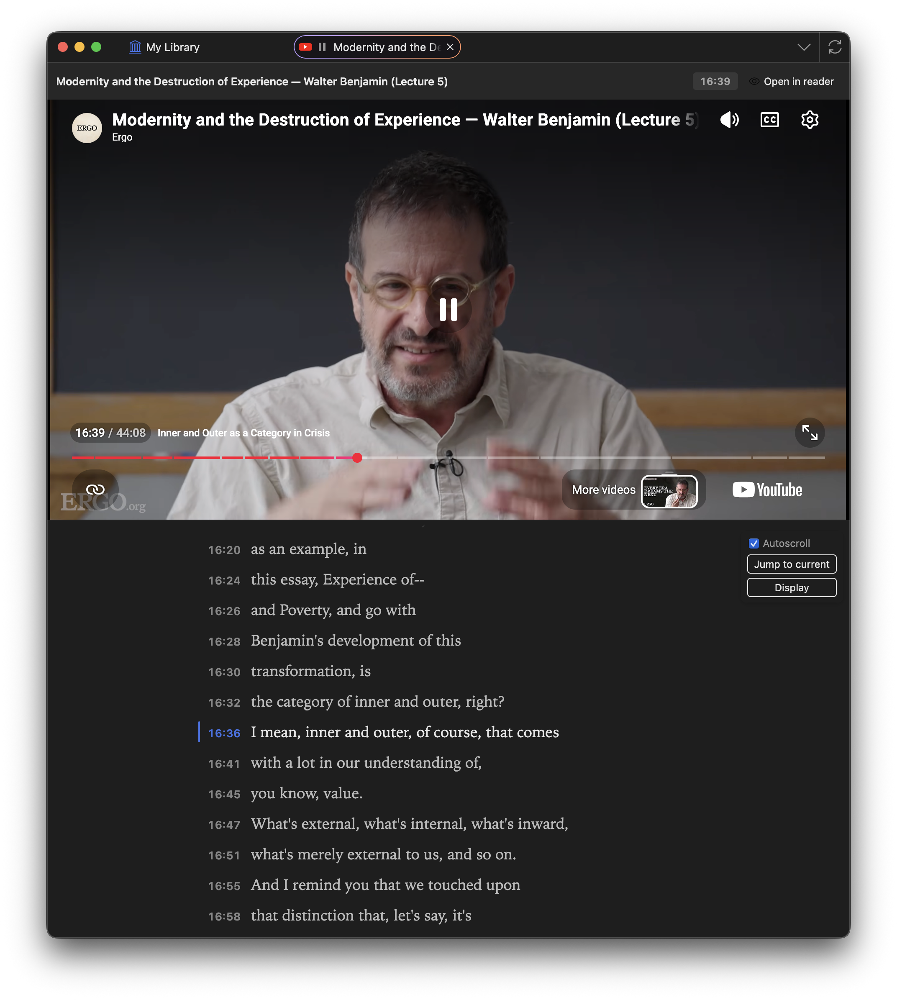

# YouTube Transcripts for Zotero

- Fetch YouTube captions into Zotero as a self-contained HTML attachment you can open and annotate in Zotero’s reader.
- Open and play youtube videos in Zotero, with a play-along transcript that you can annotate.

### Install the plugin:

1. [Download the extension file (.xpi)](https://github.com/janbaykara/zotero-youtube-transcripts/releases/latest/download/youtube-transcripts.xpi).

2. In the Zotero menu bar, go to `Tools` → `Plugins` (or `Add-ons`)

3. Click the gear icon in the top right corner and select `Install Plugin From File...`

4. Select the downloaded `.xpi` file

5. (Ensure auto-updating is enabled for this add-on too!)

6. Restart Zotero!



## Features

- Right-click a YouTube item → **Get YouTube Transcript**
- Optional auto-fetch when a YouTube item is added (off by default)
- Stores `YouTube Transcript.html` as a child attachment with clickable timestamp links
- Preferences for caption language, country code, and lines-per-timestamp

## Requirements

- Zotero 7 through 10

## Development

```bash
npm install
npm run build
npm run test:unit
npm start   # requires local Zotero + scaffold .env (see .env.example)
```

Scaffolded from [windingwind/zotero-plugin-template](https://github.com/windingwind/zotero-plugin-template).

## Usage

1. Install the built `.xpi` from `npm run build` (under `.scaffold/build`).
2. Save a YouTube video with the Zotero Connector (or add an item with a YouTube URL).
3. Right-click the item → **Get YouTube Transcript**.
4. Open the HTML attachment and annotate as with a webpage snapshot.

### “IP/bot check” errors

YouTube sometimes refuses transcript requests from VPN or datacenter IPs (`Sign in to confirm you’re not a bot`). That is not a private video — disable the VPN and try again.

## Credits

Transcript fetching and formatting logic is adapted from [YTranscript for Obsidian](https://github.com/lstrzepek/obsidian-yt-transcript) (MIT License).

## License

AGPL-3.0-or-later (plugin scaffold). Portions from YTranscript remain under MIT; see that project’s LICENSE.
